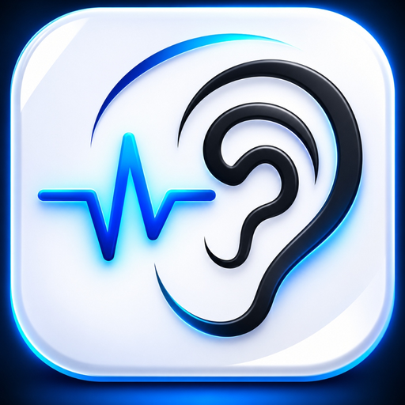
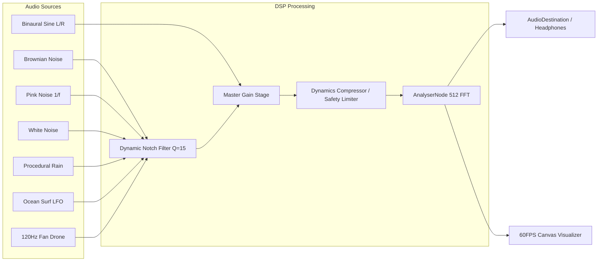

<div align="center">

  

  # 🌌 SONORA ZEN
  ### Clinical-Grade Neuroacoustic Tinnitus & Somatic Relief Suite

  [](https://heartfelt-gaufre-6435b3.netlify.app/)
  [](https://developer.mozilla.org/en-US/docs/Web/API/Web_Audio_API)
  [](https://web.dev/progressive-web-apps/)
  [](https://www.electronjs.org/)
  [](LICENSE)

  <p align="center">
    <strong>An ultra-luxury, high-performance sound therapy workstation engineered for individuals suffering from Tinnitus (phantom ear ringing) and Somatic Head Heaviness.</strong><br>
    Zero external audio assets • Pure real-time Web Audio DSP • 60 FPS Luminous Canvas Visualizer • PWA & Electron Desktop.
  </p>

  **[🌐 Experience the Live Application](https://heartfelt-gaufre-6435b3.netlify.app/)**

</div>

---

## 📖 Clinical & Scientific Background

Tinnitus is the perception of sound in the absence of an external acoustic stimulus, affecting over **15% of the global adult population**. In over 70% of non-auditory cases, tinnitus presents alongside **somatic symptoms** ("sir bhari" / suboccipital fullness, cervical spine compression, and temporomandibular joint tension).

**Sonora Zen** tackles this neuro-acoustic disorder using three evidence-based mechanisms:
1. **Tailor-Made Notched Sound Therapy (TMNMT):** Selectively filtering out a narrow frequency band (Q=15–30) centered on the user's matched tinnitus pitch. Continuous exposure induces neuroplastic auditory cortex re-tuning, dampening hyperactivity in the hyper-synchronized neuronal pool.
2. **Procedural Low-Frequency Brownian Masking:** Brownian (1/f²) random-walk noise delivers high energy in low frequencies to relieve somatic cranial pressure and cervical discomfort without ear fatigue.
3. **Brainwave Entrainment (Binaural Beats) & Vagus Activation:** Phase-shifted stereo frequencies induce relaxation-state Alpha (10 Hz) and Theta (6 Hz) brainwaves while a guided 4-7-8 respiratory rhythm stimulates parasympathetic vagal outflow to dilate inner-ear microcirculation.

---

## ⚡ Core Engineering & Architecture

### 1. 🎛️ 100% Zero-Asset Procedural Audio Engine (`audio-engine.js`)
* **Zero Network Latency & 0 KB Audio Downloads:** Unlike conventional sound apps that stream bulky MP3/WAV files, Sonora Zen generates all soundscapes mathematically on-the-fly using the Web Audio API.
* **Brownian Noise Generator:** Iterative integration of white noise with leakage:
  $$y[n] = \frac{y[n-1] + 0.02 \cdot w[n]}{1.02}$$
* **Pink Noise (1/f) Synthesis:** Paul Kellet’s refined 6-pole filter network simulating natural 3 dB/octave attenuation.
* **Modulated Biquad Wave Swells:** Ultra-low frequency LFOs (0.08–0.11 Hz) continuously modulate bandpass and lowpass filters to synthesize organic oceanic tides and gentle window rain patter.
* **Hyperacusis Protection Limiter:** Pre-master `DynamicsCompressorNode` with a strict $-12\text{ dB}$ threshold and fast 5ms attack time to safeguard sensitive ears from sudden volume spikes.



---

### 2. 🎯 Tinnitus Frequency Matcher & Precision Notch Filter
* **Dual-Mode Sine Oscillator:** Precision pitch tuner ranging from $200\text{ Hz}$ to $16,000\text{ Hz}$ with $\pm 10\text{ Hz}$ fine adjustment buttons and stereo ear panning.
* **One-Click Frequency Lock:** Immediately sets the center frequency ($f_0$) of a steep 2nd-order Biquad Notch Filter into the ambient sound processing path.

---

### 3. 🌊 60 FPS High-DPI Dual Canvas Visualizer (`visualizer.js`)
* **Zen Aura Mode:** A radiant, breathing central orb surrounded by celestial particles and harmonic ripple rings driven by real-time audio energy.
* **Neuro Spectrum Mode:** Smooth quadratic Bézier frequency curve with an illuminated gradient fill and an active vertical beacon identifying the exact Tinnitus Notch coordinate.
* **Retina Display Ready:** Dynamic canvas scaling via `window.devicePixelRatio` for razor-sharp rendering on 4K and mobile screens.

---

### 4. 📱 Mobile-First Ergonomics & PWA Compliance
* **Screen Wake Lock API:** Keeps audio playback and sleep routines uninterrupted by mobile device lockouts.
* **Mobile Floating Mini-Player:** Thumb-friendly bottom controller mimicking Spotify/Calm for effortless single-hand control.
* **Touch-Action Optimized Sliders:** Horizontal `touch-action: pan-x` prevents mobile browser scroll-jank while sliding volume.
* **Instant Mobile Audio Unlock:** Seamless iOS Safari and Android Chrome AudioContext initialization upon initial touch gesture.
* **Full Offline Support:** Complete `service-worker.js` asset caching and installable `manifest.json`.

---

## 📂 Project Structure

```bash
tinnitus_relief_app/
├── assets/
│   ├── app-icon.ico          # Multi-resolution Windows desktop icon (16px - 256px)
│   ├── icon-512.png          # High-resolution 512x512 PWA & splash icon
│   ├── icon-192.png          # Standard mobile launcher icon
│   ├── apple-touch-icon.png  # iOS Safari home screen icon
│   └── favicon.ico           # Browser tab favicon
├── css/
│   └── custom.css            # Obsidian glassmorphism theme, glowing sliders & animations
├── js/
│   ├── audio-engine.js       # Web Audio API procedural DSP synthesis engine
│   ├── visualizer.js         # 60 FPS HTML5 Canvas dual-mode audio visualizer
│   └── app.js                # State management, somatic timer, PWA install & UI controller
├── index.html                # Semantic HTML5 luxury workstation interface
├── manifest.json             # Web App Manifest for native mobile installation
├── service-worker.js         # Offline service worker caching strategy
├── main.js                   # Electron native desktop application entry point
├── package.json              # NPM dependencies and desktop scripts
├── vercel.json               # Vercel deployment & cache-control configuration
└── netlify.toml              # Netlify build and PWA headers configuration
```

---

## 🚀 Running Locally

### Option 1: Browser / Web Server
```bash
# Clone the repository
git clone https://github.com/<your-username>/sonora-zen-tinnitus-relief.git
cd sonora-zen-tinnitus-relief

# Serve with any static server (or Python)
python -m http.server 8182
# Open http://localhost:8182 in your browser
```

### Option 2: Standalone Windows Desktop App (Electron)
```bash
# Install dependencies
npm install

# Launch native desktop window with custom taskbar icon
npm start
```

---

## 🌐 Deployment
This project is pre-configured with zero-configuration deployments for:
* **Netlify:** Continuous deployment with `netlify.toml`
* **Vercel:** Optimized static caching with `vercel.json`
* **GitHub Pages:** Directly serve from the `main` branch root.

---

## 📜 Medical Advisory & Disclaimer
*Sonora Zen is designed as a non-invasive acoustic management and sound therapy tool. It does not replace professional medical diagnosis or clinical intervention. If you experience sudden unilateral tinnitus, pulsatile sensations, or severe dizziness, consult a licensed ENT specialist (Otolaryngologist) or Audiologist immediately.*

---

## 📄 License
Distributed under the **MIT License**. See `LICENSE` for more information.

---

<div align="center">
  <sub>Crafted with passion for neuro-acoustic health and restorative wellbeing.</sub>
</div>
